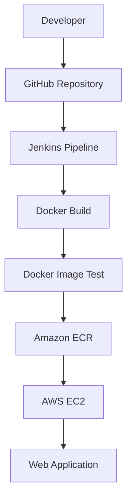

# 🚀 Hello Jenkins — CI/CD with Docker & AWS

A simple end-to-end DevOps project demonstrating how Jenkins automates the build and testing of a Dockerized web application and pushes the Docker image to Amazon Elastic Container Registry (ECR).

## 🌐 Live Demo

**Website:** http://43.204.109.125

> The demo is hosted on an AWS EC2 instance. Its public IP may change if the instance is stopped and restarted.

## 📌 Project Overview

This project demonstrates a basic CI/CD workflow using Jenkins, Docker and AWS.

Whenever the project is updated in GitHub, Jenkins retrieves the source code, builds a Docker image, validates the Nginx configuration and pushes the image to Amazon ECR.

The application is hosted on an AWS EC2 instance.

## 🛠️ Tech Stack

| Technology | Purpose |
|---|---|
| HTML | Web page structure |
| CSS | Website styling |
| Docker | Containerization |
| Nginx | Web server |
| Jenkins | CI/CD automation |
| Git & GitHub | Source code management |
| AWS ECR | Docker image registry |
| AWS EC2 | Cloud hosting |

## 🏗️ Architecture



## ⚙️ CI/CD Pipeline

The Jenkins pipeline consists of the following stages:

1. **Checkout:** Jenkins fetches the source code from GitHub.
2. **Check Tools:** Verifies Docker and AWS CLI availability.
3. **Build:** Builds a Docker image using the Dockerfile.
4. **Test:** Validates the Nginx configuration using `nginx -t`.
5. **Push:** Authenticates with Amazon ECR, tags the image and pushes it to the registry.
6. **Deploy:** An optional deployment stage is configured in the Jenkinsfile and can be enabled by setting the EC2 instance ID.

## 📂 Project Structure

```text
hello-jenkins/
│
├── Dockerfile
├── Jenkinsfile
├── index.html
└── README.md
```

## 🐳 Run Locally

**1. Clone the repository**

```bash
git clone https://github.com/PATIL-BHAGYASHREE-2926/hello-jenkins.git
```

**2. Navigate to the project**

```bash
cd hello-jenkins
```

**3. Build the Docker image**

```bash
docker build -t hello-jenkins .
```

**4. Run the container**

```bash
docker run -d -p 8080:80 --name hello-web hello-jenkins
```

**5. Open the application**

```text
http://localhost:8080
```

## ☁️ AWS Configuration

The project uses:

- **Amazon EC2:** Hosts the web application.
- **Amazon ECR:** Stores the Docker image.
- **AWS IAM:** Provides permissions for Jenkins to authenticate and push images.
- **AWS Region:** `ap-south-1` (Mumbai).

AWS credentials are stored securely in Jenkins Credentials and injected into the pipeline at runtime. They are not hardcoded in the Jenkinsfile.

## 🎯 Key Learning Outcomes

- Understanding CI/CD pipeline automation.
- Building and testing Docker images.
- Integrating Jenkins with GitHub.
- Pushing container images to Amazon ECR.
- Hosting a web application on AWS EC2.
- Managing AWS IAM permissions and credentials.

## 🔮 Future Improvements

- Enable automated deployment to EC2 through AWS Systems Manager (SSM).
- Add automated application health checks.
- Implement build versioning and rollback.
- Configure HTTPS using a domain and SSL certificate.
- Add monitoring and logging.
## 🙌 Acknowledgement

Special thanks to **[Deboistech](https://deboistech.com/)** for the guidance, learning resources and inspiration behind this mini project.

## 👩‍💻 Author

**Bhagyashree Nitin Patil**

Computer Engineering Student | Interested in Cloud Computing, DevOps and Cybersecurity.

GitHub: [PATIL-BHAGYASHREE-2926](https://github.com/PATIL-BHAGYASHREE-2926)

---

⭐ If you find this project useful, consider giving the repository a star!
