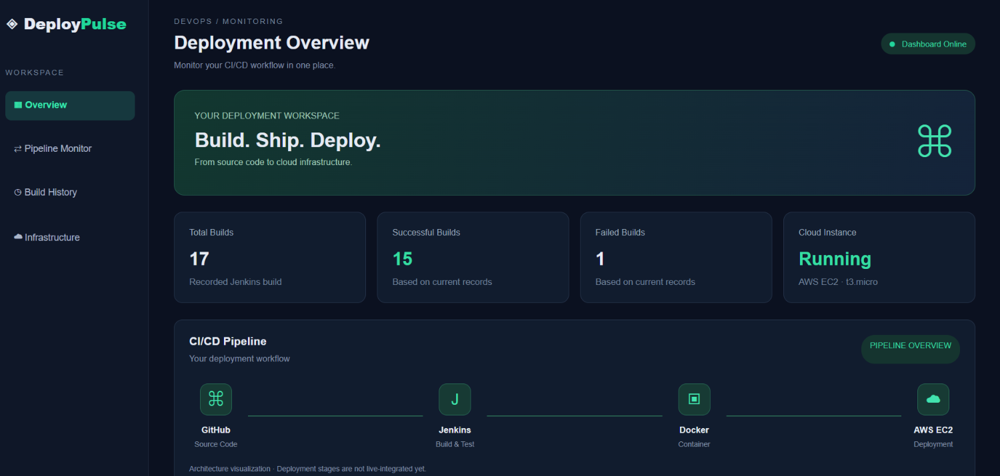
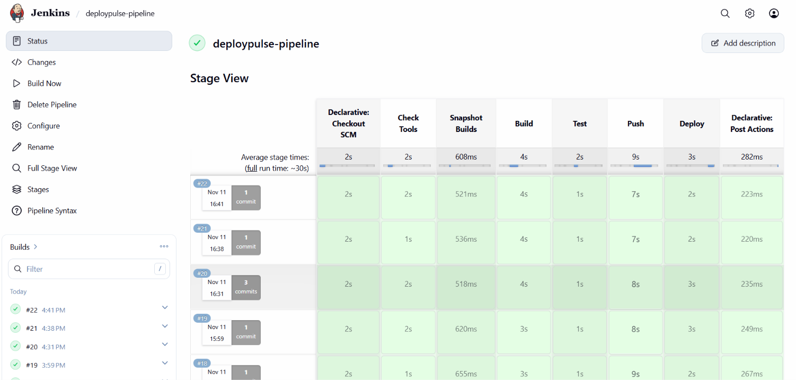
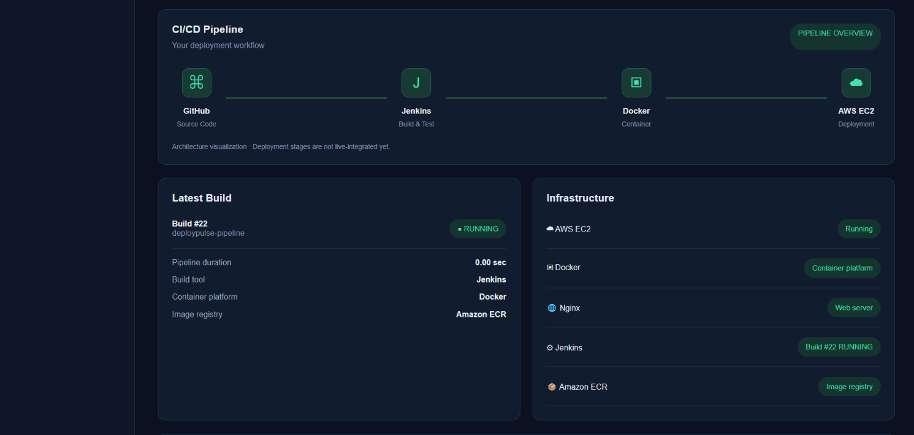

# 🚀 DeployPulse — DevOps Monitoring Dashboard

**DeployPulse** is a Jenkins-based DevOps monitoring dashboard designed to visualize CI/CD pipeline activity and deployment information. It provides an overview of build metrics, build history, the latest build, and infrastructure status.

With every pipeline execution, Jenkins builds and tests a Docker image, pushes it to **Amazon Elastic Container Registry (ECR)**, and deploys it to an **AWS EC2 instance** using **AWS Systems Manager (SSM)**.



---

## ⚙️ CI/CD Pipeline



The Jenkins pipeline automates the following stages:

1. **Checkout SCM:** Retrieves the source code from the `main` branch.
2. **Check Tools:** Verifies that Docker and AWS CLI are available.
3. **Snapshot Builds:** Generates `deploypulse/builds.json` containing Jenkins build information, allowing the EC2 dashboard to display build history without a backend.
4. **Build:** Creates the Docker image using the project's `Dockerfile`.
5. **Test:** Runs `nginx -t` inside the generated image to validate the Nginx configuration.
6. **Push:** Authenticates with Amazon ECR and pushes the Docker image.
7. **Deploy:** Sends an AWS SSM command to EC2 to pull the latest image and replace the running container.

---

## ☁️ Infrastructure



DeployPulse uses the following infrastructure components:

| Layer | Technology | Responsibility |
|---|---|---|
| Source Control | GitHub | Stores application source code |
| CI/CD | Jenkins Pipeline | Automates build, test, push, and deployment |
| Containerization | Docker (`nginx:alpine`) | Packages the dashboard |
| Image Registry | Amazon ECR | Stores Docker images |
| Hosting | AWS EC2 (`t3.micro`) | Hosts the application container |
| Deployment | AWS Systems Manager | Executes deployment commands remotely |
| Backend | Node.js + Express | Retrieves Jenkins build data locally |

---

## 🏗️ Architecture

```text
GitHub ──► Jenkins ──► Docker Image ──► Amazon ECR ──► AWS EC2
             │                                          ▲
             └──── Generates builds.json ──────────────┘
```

Jenkins generates a build snapshot and includes it in the Docker image. EC2 serves the dashboard through an Nginx container, while AWS SSM handles remote deployment.

---

## 📊 How Data Reaches the Dashboard

The frontend attempts to retrieve live Jenkins data through the backend first and falls back to the generated build snapshot when the backend is unavailable.

| Environment | Data Source | Update Frequency |
|---|---|---|
| Local development | Jenkins API through the Node.js backend (`localhost:3000`) | Every 30 seconds |
| EC2 public deployment | `builds.json` snapshot served from the same host | On each pipeline execution |

**Note:** On EC2, the current build may appear as `RUNNING` because the snapshot is generated before the pipeline finishes executing.

---

## ✨ Features

- **Build Metrics:** Displays total, successful, and failed build counts.
- **Latest Build:** Shows the latest build number, execution status, and duration.
- **Build History:** Displays build numbers, timestamps, statuses, and execution durations.
- **Infrastructure Overview:** Displays the configured infrastructure components and their status.
- **Jenkins Console Viewer:** Retrieves console logs through the local backend.
- **Sidebar Navigation:** Enables navigation between dashboard sections.
- **Automatic Refresh:** Refreshes live dashboard data every 30 seconds when the backend is available.

---

## ⚠️ Current Limitations

- **Snapshot-based EC2 data:** The public dashboard displays build information from a snapshot rather than continuously querying Jenkins. It updates when the pipeline executes.
- **Local-only console logs:** The console viewer currently works through the local backend. Public EC2 console log access is not yet integrated.
- **Local Jenkins installation:** Jenkins runs on the developer's machine at `localhost:8080`, so the EC2 instance cannot directly access it.
- **Deployment verification:** A successful Jenkins Deploy stage confirms that the SSM command was submitted, not necessarily that the container replacement completed successfully.

To inspect the actual deployment result, use:

```powershell
aws ssm list-command-invocations `
  --region ap-south-1 `
  --command-id <CommandId> `
  --details
```

Check the command status to verify whether the deployment completed successfully.

---


## 📁 Project Structure

```text
hello-jenkins/
│
├── backend/
│   ├── server.js              # Express API and Jenkins integration
│   ├── package.json
│   └── package-lock.json
│
├── deploypulse/
│   ├── index.html             # Dashboard structure
│   ├── style.css              # Dashboard styling
│   ├── script.js              # Frontend logic and data rendering
│   └── builds.json            # Jenkins build snapshot
│
├── docs/
│   ├── TROUBLESHOOTING.md     # Problems, debugging and solutions
│   ├── dashboard.png          # Dashboard screenshot
│   ├── jenkins-stage-view.png # Jenkins pipeline screenshot
│   └── infrastructure.png     # Infrastructure panel screenshot
│
├── Dockerfile                 # Nginx-based Docker image
├── Jenkinsfile                # CI/CD pipeline definition
├── deploy.json                # EC2 deployment commands
├── .gitignore
└── README.md
```

---

## 🛠️ Setup and Installation

### Prerequisites

- Windows with PowerShell and Visual Studio Code
- Node.js 18 or newer
- Docker Desktop
- AWS CLI v2 configured with an IAM identity that has the required ECR and SSM permissions
- Jenkins running locally with a Pipeline job named `deploypulse-pipeline`
- An EC2 instance configured with the SSM Agent and an IAM role that allows ECR image pulls
- Jenkins credentials configured with the IDs `aws-key-id` and `aws-secret`

### 1. Clone the repository

```powershell
git clone https://github.com/PATIL-BHAGYASHREE-2926/hello-jenkins.git
cd hello-jenkins
```

### 2. Configure the backend

Create a `.env` file inside the `backend/` directory:

```env
JENKINS_URL=http://localhost:8080
JENKINS_USER=<your-jenkins-username>
JENKINS_API_TOKEN=<your-jenkins-api-token>
```

Generate an API token from your Jenkins user's **Configure → API Token** section.

**Important:** Never commit `.env` files, Jenkins API tokens, or AWS credentials to GitHub.

### 3. Install dependencies

```powershell
cd backend
npm install
```

### 4. Start the backend

```powershell
npx nodemon server.js
```

Expected output:

```text
DeployPulse backend running at http://localhost:3000
```

Verify the backend:

```powershell
curl.exe http://localhost:3000/api/health
```

Keep the backend running while using the local dashboard.

### 5. Open the dashboard

Open `deploypulse/index.html` using the **Live Server** extension in Visual Studio Code.

Local dashboard URL:

```text
http://127.0.0.1:5500/deploypulse/index.html
```

---

## 🔌 Backend API Endpoints

The Node.js and Express backend exposes the following endpoints:

| Method | Endpoint | Description |
|---|---|---|
| GET | `/api/health` | Checks backend availability |
| GET | `/api/builds` | Retrieves Jenkins build information and metrics |
| GET | `/api/builds/:number/console` | Retrieves console output for a specific build |

---

## 🔐 Security Practices

- Jenkins API tokens are stored in `backend/.env`.
- Environment files are excluded from version control through `.gitignore`.
- AWS credentials are managed through Jenkins Credentials rather than hardcoded in the pipeline.
- Remote EC2 deployment commands are executed through AWS Systems Manager.
- The frontend does not contain Jenkins API tokens or AWS access keys.
- Temporary transfer files and archives are excluded from Git.

---

## 🗺️ Future Enhancements

- Deploy the Node.js backend on EC2 behind Nginx using an `/api` reverse proxy.
- Enable Jenkins console log viewing on the public dashboard.
- Store completed build logs in the generated snapshot.
- Display live Jenkins pipeline stage status instead of build-level status.
- Implement post-deployment health checks to verify successful container replacement.

---

## 📚 Documentation

For a detailed breakdown of the technical challenges encountered during development, their root causes, debugging process, and implemented solutions, see:

- [Troubleshooting & Problem Solving](docs/TROUBLESHOOTING.md)

---

## 👩‍💻 Author

**Bhagyashree Patil**

Built as a hands-on learning project to explore and implement **CI/CD automation, containerization, DevOps monitoring, and cloud deployment** using Jenkins, Docker, Amazon ECR, AWS EC2, and Systems Manager.

